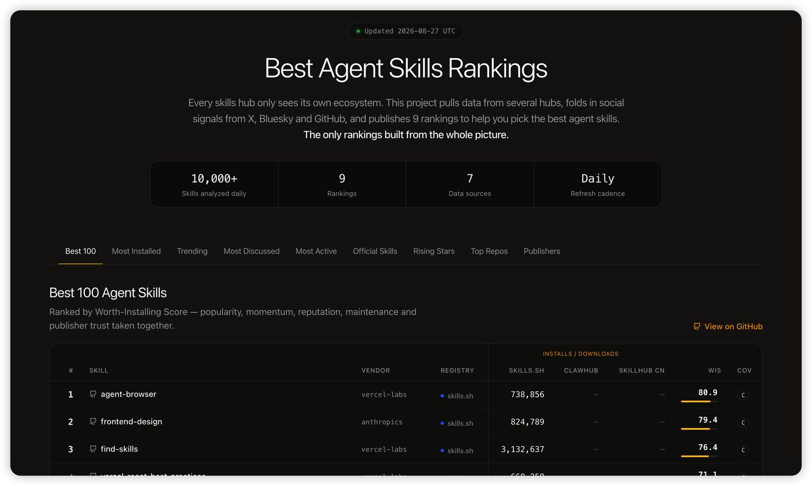

<div align="center">

# 🏆 Best Agent Skills

**Täglich aktualisierte Top-100-Ranglisten für Agent Skills – Installationen, Wachstum und soziale Resonanz, zusammengeführt aus skills.sh, ClawHub, Tencent SkillHub, GitHub, X und weiteren Quellen. Offene Daten (CSV).**

[](../data/latest)
[](#ranglisten)
[](#ranglisten)
[](../data/latest)
[](../LICENSE)
[](https://github.com/LinklyAI/best-skills)
[](https://x.com/BlueeonY)

[English](../README.md) | [简体中文](README.zh-CN.md) | [日本語](README.ja.md) | [한국어](README.ko.md) | [Español](README.es.md) | [Deutsch](README.de.md) | [Русский](README.ru.md)

Täglich aktualisiert – ⭐ **Star** für die Änderungen, oder [**@BlueeonY**](https://x.com/BlueeonY) auf X folgen.

</div>

<p align="center">
  <a href="https://linkly.ai/skills">
    
  </a>
  <br>
  <a href="https://linkly.ai/skills">Interaktive Live-Ranglisten entdecken →</a>
</p>

## Warum es dieses Projekt gibt

Jedes Skills-Verzeichnis sieht nur sein eigenes Ökosystem. skills.sh zählt Installationen über die Claude/Vercel CLI, ClawHub zählt OpenClaw-Downloads und Tencent SkillHub zählt Installationen in China – soziale Resonanz erfasst keines davon. **Best Skills verbindet all diese Perspektiven zu einem ökosystemübergreifenden Gesamtbild**: Für jeden Skill werden globale Installationen, Installationen in China und Erwähnungen in sozialen Medien nebeneinander dargestellt. Keine andere Rangliste bietet das.

- **9 Ranglisten**, täglich aktualisiert
- **Originalwerte bleiben erhalten** – jede CSV-Datei enthält die ursprünglichen Zahlen je Plattform, sodass alle Daten überprüft oder neu gewichtet werden können
- **Nicht vergleichbare Werte werden nie addiert** – plattformübergreifende Zahlen werden nebeneinander gezeigt und anhand eines zusammengesetzten Perzentilwerts innerhalb jeder Plattform eingeordnet (siehe [Methodik](methodology.md))
- **Von [jev](https://openrouter.ai/typesafe/jev-1.13) beurteilt statt nach Stichwörtern gezählt** – das Entscheidungsmodell von TypeSafe prüft, ob ein Social-Media-Beitrag wirklich vom Skill handelt, ob ein Eintrag ein echter, gepflegter Skill ist und zu welcher Kategorie er gehört; Platzhalter, veraltete und schädliche Einträge kommen nicht in die Rankings, und alle Wahrscheinlichkeiten werden veröffentlicht (siehe [Methodik](methodology.md#judgements-jev))

## Ranglisten

<!-- RANKINGS:START -->

> Zuletzt aktualisiert: **2026-10-24** (UTC) · Top-10-Vorschau je Liste – die vollständigen Top 100 stehen in den CSV-Dateien.

<details open>
<summary><b>🏆 Beste 100 (Installationswert)</b></summary>

| # | Skill | Anbieter | WIS | Abdeckung |
| --- | --- | --- | --- | --- |
| 1 | [agent-browser](https://www.skills.sh/vercel-labs/agent-browser/agent-browser) | [vercel-labs](https://www.skills.sh/vercel-labs) | 77.3 | C |
| 2 | [frontend-design](https://www.skills.sh/anthropics/skills/frontend-design) | [anthropics](https://www.skills.sh/anthropics) | 75 | C |
| 3 | [find-skills](https://www.skills.sh/vercel-labs/skills/find-skills) | [vercel-labs](https://www.skills.sh/vercel-labs) | 73.2 | C |
| 4 | [grill-me](https://www.skills.sh/mattpocock/skills/grill-me) | [mattpocock](https://www.skills.sh/mattpocock) | 70.7 | C |
| 5 | [grill-with-docs](https://www.skills.sh/mattpocock/skills/grill-with-docs) | [mattpocock](https://www.skills.sh/mattpocock) | 67.8 | C |
| 6 | [ai-image-generation](https://www.skills.sh/101-skills/superpowers/ai-image-generation) | [101-skills](https://www.skills.sh/101-skills) | 67.6 | C |
| 7 | [remotion-best-practices](https://www.skills.sh/remotion-dev/skills/remotion-best-practices) | [remotion-dev](https://www.skills.sh/remotion-dev) | 66.9 | C |
| 8 | [web-design-guidelines](https://www.skills.sh/vercel-labs/agent-skills/web-design-guidelines) | [vercel-labs](https://www.skills.sh/vercel-labs) | 66.3 | C |
| 9 | [vercel-react-best-practices](https://www.skills.sh/vercel-labs/agent-skills/vercel-react-best-practices) | [vercel-labs](https://www.skills.sh/vercel-labs) | 65.8 | C |
| 10 | [self-improving-agent](https://clawhub.ai/pskoett/skills/self-improving-agent) | — | 65.3 | B |

➡️ Vollständige Liste: [best-100.csv](../data/2026-10-24/rankings/best-100.csv)

</details>

<details>
<summary><b>📈 Meiste Installationen (alle Ökosysteme)</b></summary>

| # | Skill | skills.sh | ClawHub | SkillHub China |
| --- | --- | --- | --- | --- |
| 1 | [find-skills](https://www.skills.sh/vercel-labs/skills/find-skills) | 4,014,701 | — | — |
| 2 | dev-god | — | — | 8,015,899 |
| 3 | [grill-me](https://www.skills.sh/mattpocock/skills/grill-me) | 1,423,249 | — | — |
| 4 | multi-search-engine | — | — | 7,950,937 |
| 5 | [agent-browser](https://www.skills.sh/vercel-labs/agent-browser/agent-browser) | 1,231,814 | — | — |
| 6 | [grill-with-docs](https://www.skills.sh/mattpocock/skills/grill-with-docs) | 1,218,704 | — | — |
| 7 | dev-expert-pro | — | — | 5,259,692 |
| 8 | [self-improving-agent](https://clawhub.ai/pskoett/skills/self-improving-agent) | — | 488,016 | 1,492,176 |
| 9 | [hyperframes-cli](https://www.skills.sh/heygen-com/hyperframes/hyperframes-cli) | 1,212,280 | — | — |
| 10 | dev-expert | — | — | 4,939,549 |

➡️ Vollständige Liste: [top-installs.csv](../data/2026-10-24/rankings/top-installs.csv)

</details>

<details>
<summary><b>🚀 Trends (7 Tage)</b></summary>

| # | Skill | Installationen | Wöchentliches Δ% |
| --- | --- | --- | --- |
| 1 | [hyperframes](https://www.skills.sh/heygen-com/hyperframes/hyperframes) | 1,177,054 | 13.3 |
| 2 | [hyperframes-cli](https://www.skills.sh/heygen-com/hyperframes/hyperframes-cli) | 1,212,280 | 8.1 |
| 3 | [design-mobile-apps](https://www.skills.sh/designed-by-ai/skills/design-mobile-apps) | 998,245 | 0.2 |
| 4 | [media-use](https://www.skills.sh/heygen-com/hyperframes/media-use) | 1,082,925 | 0.7 |
| 5 | [hyperframes-registry](https://www.skills.sh/heygen-com/hyperframes/hyperframes-registry) | 983,280 | -14 |
| 6 | [find-skills](https://www.skills.sh/vercel-labs/skills/find-skills) | 4,014,701 | 9.6 |
| 7 | [ai-image-generation](https://www.skills.sh/magentosh/superpowers/ai-image-generation) | 741,250 | 14.2 |
| 8 | [ai-video-generation](https://www.skills.sh/magentosh/superpowers/ai-video-generation) | 740,879 | 14.2 |
| 9 | [ai-avatar-video](https://www.skills.sh/magentosh/superpowers/ai-avatar-video) | 740,795 | 14.2 |
| 10 | [twitter-automation](https://www.skills.sh/magentosh/superpowers/twitter-automation) | 740,676 | 14.2 |

➡️ Vollständige Liste: [trending-7d.csv](../data/2026-10-24/rankings/trending-7d.csv)

</details>

<details>
<summary><b>💬 Soziale Resonanz (X · HN · Bluesky · GitHub, 7 Tage)</b></summary>

| # | Skill | X | HN | Bluesky | GitHub |
| --- | --- | --- | --- | --- | --- |
| 1 | [grill-me](https://www.skills.sh/mattpocock/skills/grill-me) | 72+ | 2 | 10 | 37 |
| 2 | [self-improving](https://clawhub.ai/ivangdavila/skills/self-improving) | 67+ | 1 | 40 | 8 |
| 3 | [proactive-agent](https://clawhub.ai/halthelobster/skills/proactive-agent) | 86+ | 1 | 71 | 1 |
| 4 | [grill-with-docs](https://www.skills.sh/mattpocock/skills/grill-with-docs) | 14 | 1 | 2 | 12 |
| 5 | [ai-image-generation](https://www.skills.sh/101-skills/superpowers/ai-image-generation) | 30 | 1 | 38 | 1 |
| 6 | [agent-browser](https://www.skills.sh/vercel-labs/agent-browser/agent-browser) | 75+ | 0 | 1 | 43 |
| 7 | [frontend-design](https://www.skills.sh/anthropics/skills/frontend-design) | 38 | 0 | 1 | 97 |
| 8 | [browser-use](https://www.skills.sh/browser-use/browser-use/browser-use) | — | 6 | 17 | 6 |
| 9 | [self-improving-agent](https://clawhub.ai/pskoett/skills/self-improving-agent) | 41 | 0 | 7 | 2 |
| 10 | [nano-banana-pro](https://clawhub.ai/steipete/skills/nano-banana-pro) | 26 | 0 | 9 | 11 |

➡️ Vollständige Liste: [social-buzz.csv](../data/2026-10-24/rankings/social-buzz.csv)

</details>

<details>
<summary><b>🔧 Aktivste Skills (beliebt und häufig aktualisiert)</b></summary>

| # | Skill | Aktualisiert | Versionen |
| --- | --- | --- | --- |
| 1 | [chinese-official-writing](https://clawhub.ai/gongyu0918-debug/skills/chinese-official-writing) | 2026-10-23 | 157 |
| 2 | [neural-memory](https://clawhub.ai/nhadaututtheky/skills/neural-memory) | 2026-10-23 | 57 |
| 3 | [self-improving-agent](https://clawhub.ai/pskoett/skills/self-improving-agent) | 2026-10-22 | 42 |
| 4 | cloudbase | 2026-10-19 | 238 |
| 5 | [planning-with-files](https://clawhub.ai/othmanadi/skills/planning-with-files) | 2026-10-20 | 29 |
| 6 | [cellcog](https://clawhub.ai/nitishgargiitd/skills/cellcog) | 2026-10-19 | 52 |
| 7 | [getnote](https://clawhub.ai/iswalle/skills/getnote) | 2026-10-19 | 50 |
| 8 | scrapling-official | 2026-10-17 | 16 |
| 9 | web-search-plus | 2026-10-10 | 63 |
| 10 | [api-gateway](https://clawhub.ai/byungkyu/skills/api-gateway) | 2026-10-02 | 182 |

➡️ Vollständige Liste: [most-active.csv](../data/2026-10-24/rankings/most-active.csv)

</details>

<details>
<summary><b>✅ Offizielle 100 (verifizierte Herausgeber)</b></summary>

| # | Skill | Anbieter | Verifiziert durch |
| --- | --- | --- | --- |
| 1 | [find-skills](https://www.skills.sh/vercel-labs/skills/find-skills) | [vercel-labs](https://www.skills.sh/vercel-labs) | skills.sh |
| 2 | dev-god | 阿客（北京）科技有限公司 | skillhub |
| 3 | multi-search-engine | 成都智创未来教育管理合伙企业（有限合伙） | skillhub |
| 4 | [agent-browser](https://www.skills.sh/vercel-labs/agent-browser/agent-browser) | [vercel-labs](https://www.skills.sh/vercel-labs) | skills.sh |
| 5 | tencent-docs | 腾讯科技（深圳）有限公司 | skillhub |
| 6 | [frontend-design](https://www.skills.sh/anthropics/skills/frontend-design) | [anthropics](https://www.skills.sh/anthropics) | skills.sh |
| 7 | aigccerts | 成都国信公链科技有限公司 | skillhub |
| 8 | beatra | 乐萱同行科技（深圳）有限公司 | skillhub |
| 9 | cic | 成都国信公链科技有限公司 | skillhub |
| 10 | [github](https://clawhub.ai/steipete/skills/github) | [steipete](https://clawhub.ai/steipete) | clawhub |

➡️ Vollständige Liste: [official-100.csv](../data/2026-10-24/rankings/official-100.csv)

</details>

<details>
<summary><b>🏢 Offizielle Anbieter (nach Plattform gruppiert)</b></summary>

| # | Plattform | Anbieter | Skills | Installationen/Downloads |
| --- | --- | --- | --- | --- |
| 1 | [skills.sh](https://www.skills.sh) | [microsoft](https://www.skills.sh/microsoft) | 582 | 7,098,914 |
| 2 | [skills.sh](https://www.skills.sh) | [vercel-labs](https://www.skills.sh/vercel-labs) | 252 | 3,192,303 |
| 3 | [skills.sh](https://www.skills.sh) | [github](https://www.skills.sh/github) | 406 | 2,002,122 |
| 4 | [skills.sh](https://www.skills.sh) | [anthropics](https://www.skills.sh/anthropics) | 605 | 1,942,412 |
| 5 | [skills.sh](https://www.skills.sh) | [firebase](https://www.skills.sh/firebase) | 55 | 685,617 |
| 6 | [skills.sh](https://www.skills.sh) | [firecrawl](https://www.skills.sh/firecrawl) | 286 | 482,310 |
| 7 | [skills.sh](https://www.skills.sh) | [nvidia](https://www.skills.sh/nvidia) | 1250 | 433,517 |
| 8 | [skills.sh](https://www.skills.sh) | [remotion-dev](https://www.skills.sh/remotion-dev) | 19 | 305,359 |
| 9 | [skills.sh](https://www.skills.sh) | [flutter](https://www.skills.sh/flutter) | 88 | 286,211 |
| 10 | [skills.sh](https://www.skills.sh) | [expo](https://www.skills.sh/expo) | 18 | 283,306 |

➡️ Vollständige Liste: [official-vendors.csv](../data/2026-10-24/rankings/official-vendors.csv)

</details>

<details>
<summary><b>⭐ Top-Repositorys</b></summary>

| # | Repository | Stars | Letzter Push |
| --- | --- | --- | --- |
| 1 | [obra/superpowers](https://github.com/obra/superpowers) | 304,237 | 2026-10-23 |
| 2 | [mattpocock/skills](https://github.com/mattpocock/skills) | 301,817 | 2026-10-22 |
| 3 | [affaan-m/ECC](https://github.com/affaan-m/ECC) | 287,331 | 2026-10-20 |
| 4 | [anthropics/skills](https://github.com/anthropics/skills) | 183,297 | 2026-10-09 |
| 5 | [DietrichGebert/ponytail](https://github.com/DietrichGebert/ponytail) | 174,798 | 2026-10-18 |
| 6 | [anthropics/claude-code](https://github.com/anthropics/claude-code) | 153,174 | 2026-10-23 |
| 7 | [nextlevelbuilder/ui-ux-pro-max-skill](https://github.com/nextlevelbuilder/ui-ux-pro-max-skill) | 139,439 | 2026-10-23 |
| 8 | [shadcn-ui/ui](https://github.com/shadcn-ui/ui) | 126,366 | 2026-10-23 |
| 9 | [browser-use/browser-use](https://github.com/browser-use/browser-use) | 118,983 | 2026-10-24 |
| 10 | [JuliusBrussee/caveman](https://github.com/JuliusBrussee/caveman) | 114,632 | 2026-10-24 |

➡️ Vollständige Liste: [top-repos.csv](../data/2026-10-24/rankings/top-repos.csv)

</details>

<details>
<summary><b>🌱 Aufsteiger (jünger als 30 Tage)</b></summary>

| # | Skill | Alter (Tage) | Beliebtheit |
| --- | --- | --- | --- |
| 1 | dev-god | 16 | 0.999 |
| 2 | dev-expert-pro | 8 | 0.997 |
| 3 | aigccerts | 7 | 0.99 |
| 4 | cic | 26 | 0.987 |
| 5 | xique-tender-pay | 16 | 0.914 |
| 6 | course-video-studio | 12 | 0.905 |
| 7 | patent-oa-response-cn | 28 | 0.887 |
| 8 | course-narration-studio | 12 | 0.884 |
| 9 | self-improving | 29 | 0.859 |
| 10 | telehot-tender-review | 24 | 0.85 |

➡️ Vollständige Liste: [rising-stars.csv](../data/2026-10-24/rankings/rising-stars.csv)

</details>

<!-- RANKINGS:END -->

### Bedeutung der einzelnen Listen

| Liste | Rangfolge nach |
| --- | --- |
| `best-100` | Gesamtwert der Installation (Beliebtheit + Dynamik + Resonanz + Pflege + Vertrauen) |
| `top-installs` | Meiste Installationen über alle Ökosysteme hinweg |
| `trending-7d` | Schnellstes Wachstum in den letzten 7 Tagen |
| `social-buzz` | Meiste Erwähnungen auf X, Hacker News, Bluesky und GitHub (Skills mit generischen Namen werden ausgeschlossen, da ihre Erwähnungen nicht eindeutig zugeordnet werden können) |
| `most-active` | Am häufigsten aktualisierte beliebte Skills |
| `official-100` | Beliebteste Skills verifizierter Herausgeber |
| `official-vendors` | Verifizierte Anbieter nach Gesamtinstallationen |
| `top-repos` | GitHub-Repositorys hinter den Skills, sortiert nach Stars |
| `rising-stars` | Beste Neuzugänge, die vor weniger als 30 Tagen erstmals erfasst wurden |

## Daten

```text
data/
├── YYYY-MM-DD/
│   ├── raw/                # unveränderte Originalwerte je Plattform
│   │   ├── skills-sh.csv · clawhub.csv · skillhub.csv · github-repos.csv
│   │   └── buzz.csv · x-posts.csv · judgments.csv · …
│   └── rankings/           # die 9 aus raw/ berechneten Ranglisten
│       ├── best-100.csv · top-installs.csv · trending-7d.csv
│       └── social-buzz.csv · … · rising-stars.csv
├── latest/                 # stets eine Kopie des neuesten Tages
└── index/
    └── first-seen.csv      # fortlaufende Daten der ersten Erfassung (für Aufsteiger)
```

Ein Ordner pro Tag, ausschließlich CSV-Dateien. Zusammengesetzte Werte enthalten stets auch die ursprünglichen plattformspezifischen Zahlen, aus denen sie berechnet wurden. Wenn du nur die heutigen Listen ansehen möchtest, beginne mit `data/latest/`.

Weitere Informationen zu Datenquellen, Normalisierung und bekannten Einschränkungen findest du unter [docs/methodology.md](methodology.md).

## Datenquellen und Quellenangaben

Installations- und Downloadzahlen stammen aus öffentlichen Endpunkten von [skills.sh](https://www.skills.sh), [ClawHub](https://clawhub.ai) (gemäß dessen Richtlinie für Drittanbieter-Verzeichnisse; Skill-Seiten verlinken auf den jeweiligen offiziellen ClawHub-Eintrag), [Tencent SkillHub](https://skillhub.cn) und der [GitHub API](https://docs.github.com). Soziale Signale stammen von X, [Hacker News (Algolia)](https://hn.algolia.com), [Bluesky](https://bsky.app) und der GitHub-Suche. Dieses Projekt wird von keiner dieser Plattformen unterstützt und steht mit ihnen nicht in Verbindung. Die Zahlen folgen der jeweiligen plattformeigenen Methodik und werden niemals plattformübergreifend addiert.

## Lizenz

Daten und Dokumentation stehen unter [CC BY 4.0](../LICENSE) und dürfen frei verwendet, weiterverbreitet und bearbeitet werden – auch kommerziell.

### Quellenangabe

Füge dort, wo die Daten erscheinen, diese Zeile ein:

> Data from [Best Skills](https://github.com/LinklyAI/best-skills) by [@BlueeonY](https://x.com/BlueeonY) — [CC BY 4.0](https://creativecommons.org/licenses/by/4.0/)

Behalte den Link auf dieses Repository und die oben genannten Quellenangaben der Plattformen bei. Mehr ist nicht erforderlich – es braucht keine gesonderte Genehmigung.

Etwas damit gebaut? [@BlueeonY](https://x.com/BlueeonY) würde es gern sehen – die Lizenz verlangt das nicht, wir freuen uns aber darüber.

---

Entwickelt von [@BlueeonY](https://x.com/BlueeonY) bei [Linkly AI](https://linkly.ai) – einer KI-gestützten lokalen Wissensdatenbank mit Unterstützung für Agent Skills.

Hilfreich? Ein ⭐ hilft anderen, das Projekt zu finden.
