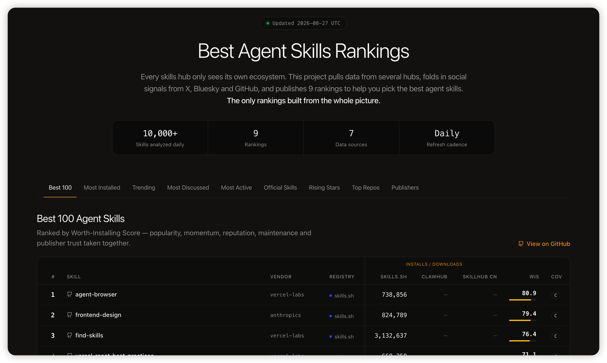

<div align="center">

# 🏆 Best Agent Skills

**Ежедневно обновляемые рейтинги Top 100 Agent Skills — установки, рост и обсуждаемость, собранные из skills.sh, ClawHub, Tencent SkillHub, GitHub, X и других источников. Открытые данные (CSV).**

[](../data/latest)
[](#рейтинги)
[](#рейтинги)
[](../data/latest)
[](../LICENSE)
[](https://github.com/LinklyAI/best-skills)
[](https://x.com/BlueeonY)

[English](../README.md) | [简体中文](README.zh-CN.md) | [日本語](README.ja.md) | [한국어](README.ko.md) | [Español](README.es.md) | [Deutsch](README.de.md) | [Русский](README.ru.md)

Рейтинги меняются каждый день — поставьте ⭐ **Star**, чтобы следить за обновлениями, или подпишитесь на [**@BlueeonY**](https://x.com/BlueeonY) в X.

</div>

<p align="center">
  <a href="https://linkly.ai/skills">
    
  </a>
  <br>
  <a href="https://linkly.ai/skills">Открыть интерактивные рейтинги →</a>
</p>

## Зачем нужен этот проект

Каждый каталог skills видит только собственную экосистему. skills.sh считает установки через Claude/Vercel CLI, ClawHub — загрузки OpenClaw, Tencent SkillHub — установки в Китае, но ни один из них не отражает обсуждаемость в сообществе. **Best Skills объединяет эти источники в единую межплатформенную картину**: для каждого skill рядом показаны глобальные установки, установки в Китае и упоминания в социальных сетях. Другого рейтинга с таким охватом нет.

- **9 рейтингов**, обновляются ежедневно
- **Исходные значения сохраняются** — каждый CSV содержит оригинальные показатели по платформам, поэтому данные можно проверить или пересчитать
- **Несопоставимые показатели не складываются** — данные разных платформ показаны рядом, а итоговый рейтинг строится по составному перцентильному баллу внутри каждой платформы (см. [методологию](methodology.md))
- **Оценивает [jev](https://openrouter.ai/typesafe/jev-1.13), а не подсчёт ключевых слов** — модель принятия решений TypeSafe проверяет, действительно ли пост в соцсетях посвящён навыку, является ли запись настоящим поддерживаемым навыком и к какой категории он относится; заглушки, устаревшие и вредоносные записи не попадают в рейтинги, а все вероятности публикуются (см. [методологию](methodology.md#judgements-jev))

## Рейтинги

<!-- RANKINGS:START -->

> Последнее обновление: **2026-11-13** (UTC) · Предпросмотр Top 10 для каждого рейтинга — полный Top 100 доступен в CSV.

<details open>
<summary><b>🏆 Лучшие 100 (рейтинг целесообразности установки)</b></summary>

| # | Skill | Издатель | WIS | Охват |
| --- | --- | --- | --- | --- |
| 1 | [agent-browser](https://www.skills.sh/vercel-labs/agent-browser/agent-browser) | [vercel-labs](https://www.skills.sh/vercel-labs) | 81.9 | C |
| 2 | [find-skills](https://www.skills.sh/vercel-labs/skills/find-skills) | [vercel-labs](https://www.skills.sh/vercel-labs) | 76.3 | C |
| 3 | [frontend-design](https://www.skills.sh/anthropics/skills/frontend-design) | [anthropics](https://www.skills.sh/anthropics) | 72.2 | C |
| 4 | [remotion-best-practices](https://www.skills.sh/remotion-dev/skills/remotion-best-practices) | [remotion-dev](https://www.skills.sh/remotion-dev) | 67.2 | C |
| 5 | [microsoft-foundry](https://www.skills.sh/microsoft/azure-skills/microsoft-foundry) | [microsoft](https://www.skills.sh/microsoft) | 66.8 | C |
| 6 | [azure-diagnostics](https://www.skills.sh/microsoft/azure-skills/azure-diagnostics) | [microsoft](https://www.skills.sh/microsoft) | 66.7 | C |
| 7 | [azure-ai](https://www.skills.sh/microsoft/azure-skills/azure-ai) | [microsoft](https://www.skills.sh/microsoft) | 66.7 | C |
| 8 | [azure-validate](https://www.skills.sh/microsoft/azure-skills/azure-validate) | [microsoft](https://www.skills.sh/microsoft) | 66.6 | C |
| 9 | [azure-compliance](https://www.skills.sh/microsoft/azure-skills/azure-compliance) | [microsoft](https://www.skills.sh/microsoft) | 66.6 | C |
| 10 | [azure-prepare](https://www.skills.sh/microsoft/azure-skills/azure-prepare) | [microsoft](https://www.skills.sh/microsoft) | 66.5 | C |

➡️ Полный список: [best-100.csv](../data/2026-11-13/rankings/best-100.csv)

</details>

<details>
<summary><b>📈 Лидеры по установкам (все экосистемы)</b></summary>

| # | Skill | skills.sh | ClawHub | SkillHub Китай |
| --- | --- | --- | --- | --- |
| 1 | [find-skills](https://www.skills.sh/vercel-labs/skills/find-skills) | 4,334,307 | — | — |
| 2 | dev-god | — | — | 11,437,698 |
| 3 | [grill-me](https://www.skills.sh/mattpocock/skills/grill-me) | 1,542,895 | — | — |
| 4 | multi-search-engine | — | — | 10,965,114 |
| 5 | [hyperframes-cli](https://www.skills.sh/heygen-com/hyperframes/hyperframes-cli) | 1,537,429 | — | — |
| 6 | [agent-browser](https://www.skills.sh/vercel-labs/agent-browser/agent-browser) | 1,504,140 | — | — |
| 7 | dev-expert-pro | — | — | 6,301,633 |
| 8 | [hyperframes](https://www.skills.sh/heygen-com/hyperframes/hyperframes) | 1,500,058 | — | — |
| 9 | dev-expert | — | — | 6,072,364 |
| 10 | [media-use](https://www.skills.sh/heygen-com/hyperframes/media-use) | 1,409,842 | — | — |

➡️ Полный список: [top-installs.csv](../data/2026-11-13/rankings/top-installs.csv)

</details>

<details>
<summary><b>🚀 В тренде (7 дней)</b></summary>

| # | Skill | Установки | Недельный Δ% |
| --- | --- | --- | --- |
| 1 | [design-mobile-apps](https://www.skills.sh/designed-by-ai/skills/design-mobile-apps) | 1,390,000 | 1.5 |
| 2 | [agent-browser](https://www.skills.sh/vercel-labs/agent-browser/agent-browser) | 1,504,140 | 18.8 |
| 3 | [find-skills](https://www.skills.sh/vercel-labs/skills/find-skills) | 4,334,307 | -4.5 |
| 4 | [hyperframes](https://www.skills.sh/heygen-com/hyperframes/hyperframes) | 1,500,058 | -14.9 |
| 5 | [media-use](https://www.skills.sh/heygen-com/hyperframes/media-use) | 1,409,842 | -17.1 |
| 6 | [hyperframes-cli](https://www.skills.sh/heygen-com/hyperframes/hyperframes-cli) | 1,537,429 | -17.9 |
| 7 | [reverse-any-video](https://www.skills.sh/heygen-com/hyperframes/reverse-any-video) | 76,341 | — |
| 8 | [hyperframes-registry](https://www.skills.sh/heygen-com/hyperframes/hyperframes-registry) | 1,286,814 | -16.6 |
| 9 | [style-sampling](https://www.skills.sh/heygen-com/hyperframes/style-sampling) | 69,837 | — |
| 10 | [ai-video-generation](https://www.skills.sh/bankai-skills/superpowers/ai-video-generation) | 591,318 | 15.5 |

➡️ Полный список: [trending-7d.csv](../data/2026-11-13/rankings/trending-7d.csv)

</details>

<details>
<summary><b>💬 Обсуждаемость (X · HN · Bluesky · GitHub, 7 дней)</b></summary>

| # | Skill | X | HN | Bluesky | GitHub |
| --- | --- | --- | --- | --- | --- |
| 1 | [agent-browser](https://www.skills.sh/vercel-labs/agent-browser/agent-browser) | 70+ | 2 | 24 | 50 |
| 2 | self-improving | 58+ | 8 | 37 | 6 |
| 3 | [self-improving-agent](https://clawhub.ai/pskoett/skills/self-improving-agent) | 55 | 1 | 4 | 2 |
| 4 | [ai-video-generation](https://www.skills.sh/101-skills/superpowers/ai-video-generation) | 11 | 1 | 11 | 1 |
| 5 | [grill-me](https://www.skills.sh/mattpocock/skills/grill-me) | 81+ | 0 | 7 | 33 |
| 6 | [skill-creator](https://www.skills.sh/anthropics/skills/skill-creator) | 48 | 0 | 4 | 124 |
| 7 | [grill-with-docs](https://www.skills.sh/mattpocock/skills/grill-with-docs) | 13 | 1 | 0 | 9 |
| 8 | [browser-use](https://www.skills.sh/browser-use/browser-use/browser-use) | — | 5 | 26 | 20 |
| 9 | [nano-banana-pro](https://clawhub.ai/steipete/skills/nano-banana-pro) | 24 | 0 | 6 | 33 |
| 10 | [find-skills](https://www.skills.sh/vercel-labs/skills/find-skills) | 11 | 0 | 3 | 197 |

➡️ Полный список: [social-buzz.csv](../data/2026-11-13/rankings/social-buzz.csv)

</details>

<details>
<summary><b>🔧 Самые активные (популярные и регулярно обновляемые)</b></summary>

| # | Skill | Обновлено | Версии |
| --- | --- | --- | --- |
| 1 | [chinese-official-writing](https://clawhub.ai/gongyu0918-debug/skills/chinese-official-writing) | 2026-11-12 | 170 |
| 2 | [planning-with-files](https://clawhub.ai/othmanadi/skills/planning-with-files) | 2026-11-10 | 30 |
| 3 | [api-gateway](https://clawhub.ai/byungkyu/skills/api-gateway) | 2026-11-07 | 191 |
| 4 | [getnote](https://clawhub.ai/iswalle/skills/getnote) | 2026-11-06 | 52 |
| 5 | scrapling-official | 2026-11-05 | 17 |
| 6 | tencent-cos-skill | 2026-11-04 | 16 |
| 7 | video-generation-cellcog | 2026-11-01 | 20 |
| 8 | image-generation-cellcog | 2026-11-01 | 19 |
| 9 | creative-writing-cellcog | 2026-11-01 | 17 |
| 10 | neural-memory | 2026-10-23 | 57 |

➡️ Полный список: [most-active.csv](../data/2026-11-13/rankings/most-active.csv)

</details>

<details>
<summary><b>✅ Официальные 100 (проверенные издатели)</b></summary>

| # | Skill | Издатель | Проверено |
| --- | --- | --- | --- |
| 1 | [find-skills](https://www.skills.sh/vercel-labs/skills/find-skills) | [vercel-labs](https://www.skills.sh/vercel-labs) | skills.sh |
| 2 | dev-god | 阿客（北京）科技有限公司 | skillhub |
| 3 | multi-search-engine | 成都智创未来教育管理合伙企业（有限合伙） | skillhub |
| 4 | [agent-browser](https://www.skills.sh/vercel-labs/agent-browser/agent-browser) | [vercel-labs](https://www.skills.sh/vercel-labs) | skills.sh |
| 5 | aigccerts | 成都国信公链科技有限公司 | skillhub |
| 6 | tencent-docs | 腾讯科技（深圳）有限公司 | skillhub |
| 7 | [frontend-design](https://www.skills.sh/anthropics/skills/frontend-design) | [anthropics](https://www.skills.sh/anthropics) | skills.sh |
| 8 | beatra | 乐萱同行科技（深圳）有限公司 | skillhub |
| 9 | cic | 成都国信公链科技有限公司 | skillhub |
| 10 | ima-skills | 腾讯科技（深圳）有限公司 | skillhub |

➡️ Полный список: [official-100.csv](../data/2026-11-13/rankings/official-100.csv)

</details>

<details>
<summary><b>🏢 Официальные издатели (по платформам)</b></summary>

| # | Платформа | Издатель | Skills | Установки/скачивания |
| --- | --- | --- | --- | --- |
| 1 | [skills.sh](https://www.skills.sh) | [microsoft](https://www.skills.sh/microsoft) | 582 | 7,098,914 |
| 2 | [skills.sh](https://www.skills.sh) | [vercel-labs](https://www.skills.sh/vercel-labs) | 252 | 3,192,303 |
| 3 | [skills.sh](https://www.skills.sh) | [github](https://www.skills.sh/github) | 406 | 2,002,122 |
| 4 | [skills.sh](https://www.skills.sh) | [anthropics](https://www.skills.sh/anthropics) | 605 | 1,942,412 |
| 5 | [skills.sh](https://www.skills.sh) | [firebase](https://www.skills.sh/firebase) | 55 | 685,617 |
| 6 | [skills.sh](https://www.skills.sh) | [firecrawl](https://www.skills.sh/firecrawl) | 286 | 482,310 |
| 7 | [skills.sh](https://www.skills.sh) | [nvidia](https://www.skills.sh/nvidia) | 1296 | 442,028 |
| 8 | [skills.sh](https://www.skills.sh) | [remotion-dev](https://www.skills.sh/remotion-dev) | 19 | 305,359 |
| 9 | [skills.sh](https://www.skills.sh) | [flutter](https://www.skills.sh/flutter) | 88 | 286,211 |
| 10 | [skills.sh](https://www.skills.sh) | [expo](https://www.skills.sh/expo) | 18 | 283,306 |

➡️ Полный список: [official-vendors.csv](../data/2026-11-13/rankings/official-vendors.csv)

</details>

<details>
<summary><b>⭐ Лучшие репозитории</b></summary>

| # | Репозиторий | Stars | Последний push |
| --- | --- | --- | --- |
| 1 | [mattpocock/skills](https://github.com/mattpocock/skills) | 323,011 | 2026-11-12 |
| 2 | [obra/superpowers](https://github.com/obra/superpowers) | 316,768 | 2026-11-03 |
| 3 | [anthropics/skills](https://github.com/anthropics/skills) | 193,698 | 2026-11-06 |
| 4 | [DietrichGebert/ponytail](https://github.com/DietrichGebert/ponytail) | 189,783 | 2026-10-29 |
| 5 | [anthropics/claude-code](https://github.com/anthropics/claude-code) | 155,447 | 2026-11-12 |
| 6 | [nextlevelbuilder/ui-ux-pro-max-skill](https://github.com/nextlevelbuilder/ui-ux-pro-max-skill) | 148,669 | 2026-11-10 |
| 7 | [vercel/next.js](https://github.com/vercel/next.js) | 143,496 | 2026-11-13 |
| 8 | [shadcn-ui/ui](https://github.com/shadcn-ui/ui) | 128,027 | 2026-11-12 |
| 9 | [stablyai/orca](https://github.com/stablyai/orca) | 123,481 | 2026-11-13 |
| 10 | [browser-use/browser-use](https://github.com/browser-use/browser-use) | 120,853 | 2026-11-12 |

➡️ Полный список: [top-repos.csv](../data/2026-11-13/rankings/top-repos.csv)

</details>

<details>
<summary><b>🌱 Восходящие звёзды (младше 30 дней)</b></summary>

| # | Skill | Возраст (дни) | Популярность |
| --- | --- | --- | --- |
| 1 | dev-expert-pro | 28 | 0.997 |
| 2 | aigccerts | 27 | 0.995 |
| 3 | proactive-agent | 17 | 0.829 |
| 4 | slide-narration-studio | 29 | 0.822 |
| 5 | micro-lesson-maker | 29 | 0.806 |
| 6 | patent-novelty-i | 18 | 0.776 |
| 7 | patent-disclosure-i | 18 | 0.77 |
| 8 | patent-search-i | 19 | 0.766 |
| 9 | lecture-video-maker | 29 | 0.763 |
| 10 | dknownai-guard | 22 | 0.748 |

➡️ Полный список: [rising-stars.csv](../data/2026-11-13/rankings/rising-stars.csv)

</details>

<!-- RANKINGS:END -->

### Что означает каждый список

| Список             | Что он ранжирует                                                                                                              |
| ------------------ | ----------------------------------------------------------------------------------------------------------------------------- |
| `best-100`         | Общий Worth-Installing Score: популярность, динамика, обсуждаемость, поддержка и доверие к издателю                            |
| `top-installs`     | Самые устанавливаемые skills во всех экосистемах                                                                              |
| `trending-7d`      | Skills с самым быстрым ростом за последние 7 дней                                                                             |
| `social-buzz`      | Самые обсуждаемые skills в X, Hacker News, Bluesky и GitHub; skills с общими названиями исключены из-за неточной атрибуции     |
| `most-active`      | Популярные skills, которые обновляются чаще всего                                                                              |
| `official-100`     | Самые популярные skills от проверенных издателей                                                                               |
| `official-vendors` | Проверенные издатели по суммарным установкам                                                                                   |
| `top-repos`        | GitHub-репозитории, стоящие за skills, по количеству stars                                                                     |
| `rising-stars`     | Лучшие новые skills, впервые замеченные менее 30 дней назад                                                                    |

## Данные

```text
data/
├── YYYY-MM-DD/
│   ├── raw/                # исходные показатели по платформам без изменений
│   │   ├── skills-sh.csv · clawhub.csv · skillhub.csv · github-repos.csv
│   │   └── buzz.csv · x-posts.csv · judgments.csv · …
│   └── rankings/           # 9 рейтингов, рассчитанных из raw/
│       ├── best-100.csv · top-installs.csv · trending-7d.csv
│       └── social-buzz.csv · … · rising-stars.csv
├── latest/                 # копия данных за последний доступный день
└── index/
    └── first-seen.csv      # накопленные даты первого появления для rising-stars
```

На каждый день создаётся отдельная папка только с CSV. Составные оценки всегда публикуются вместе с исходными показателями по платформам, из которых они рассчитаны. Если нужны сегодняшние списки, начните с `data/latest/`.

Источники данных, правила нормализации и известные ограничения описаны в [методологии](methodology.md).

## Источники и атрибуция

Количество установок и загрузок собирается из открытых API [skills.sh](https://www.skills.sh), [ClawHub](https://clawhub.ai) (в соответствии с политикой сторонних каталогов; страницы skills содержат ссылки на оригинальные страницы ClawHub), [Tencent SkillHub](https://skillhub.cn) и [GitHub API](https://docs.github.com). Социальные сигналы поступают из X, [Hacker News (Algolia)](https://hn.algolia.com), [Bluesky](https://bsky.app) и поиска GitHub. Проект не связан с этими платформами и не поддерживается ими. Показатели следуют методологии каждой платформы и никогда не складываются между платформами.

## Лицензия

Данные и документация опубликованы по лицензии [CC BY 4.0](../LICENSE): их можно свободно использовать, распространять и применять в коммерческих проектах.

### Как указать источник

Добавьте эту строку там, где используются данные:

> Data from [Best Skills](https://github.com/LinklyAI/best-skills) by [@BlueeonY](https://x.com/BlueeonY) — [CC BY 4.0](https://creativecommons.org/licenses/by/4.0/)

Сохраните ссылку на этот репозиторий и атрибуцию платформ, перечисленных выше. Это всё, что требуется; отдельное разрешение не нужно.

Создали что-то на основе этих данных? [@BlueeonY](https://x.com/BlueeonY) будет рад увидеть результат — это не требование лицензии, а просто пожелание.

---

Проект создан [@BlueeonY](https://x.com/BlueeonY) в [Linkly AI](https://linkly.ai) — локальной базе знаний с AI и поддержкой agent skills.

Проект оказался полезен? ⭐ поможет большему числу людей его найти.
