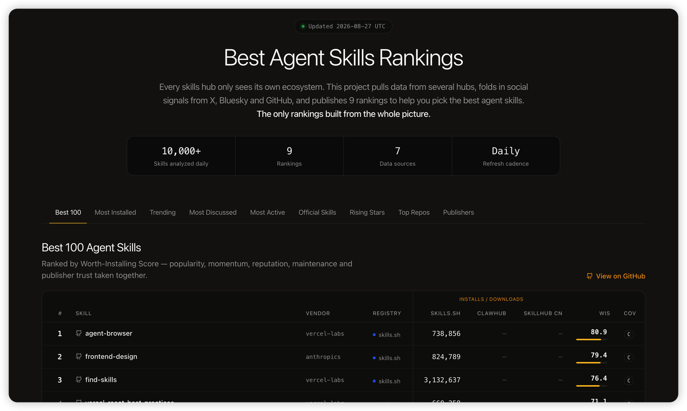

<div align="center">

# 🏆 Best Agent Skills

**每日更新的 Agent Skills Top 100 排行榜——聚合来自 skills.sh、ClawHub、腾讯 SkillHub、GitHub、X 等平台的安装量、增长趋势和社交热度。开放数据（CSV）。**

[](../data/latest)
[](#排行榜)
[](#排行榜)
[](../data/latest)
[](../LICENSE)
[](https://github.com/LinklyAI/best-skills)
[](https://x.com/BlueeonY)

[English](../README.md) | [简体中文](README.zh-CN.md) | [日本語](README.ja.md) | [한국어](README.ko.md) | [Español](README.es.md) | [Deutsch](README.de.md) | [Русский](README.ru.md)

排行榜每天更新——⭐ **Star** 追更新，或在 X 关注 [**@BlueeonY**](https://x.com/BlueeonY) 看每日异动。

</div>

<p align="center">
  <a href="https://linkly.ai/skills">
    
  </a>
  <br>
  <a href="https://linkly.ai/skills">探索实时交互榜单 →</a>
</p>

## 为什么创建这个项目

每个 Skills 注册平台只能看到自己的生态。skills.sh 统计 Claude/Vercel CLI 安装量，ClawHub 统计 OpenClaw 下载量，腾讯 SkillHub 统计中国区安装量——而它们都无法反映社交热度。**Best Skills 将这些视角合并成一个跨生态全景**：你可以并排查看每个 Skill 的全球安装量、中国区安装量和社交提及量。没有其他排行榜能做到这一点。

- **9 个排行榜**，每日刷新
- **保留原始数据**——每份 CSV 都保存各平台的原始计数，任何人都可以验证或重新排名
- **绝不混加不可比数据**——跨平台数据并排展示，并按各平台内部的百分位综合得分排名（参见[方法论](methodology.md)）
- **由 [jev](https://openrouter.ai/typesafe/jev-1.13) 判定，而非关键词计数**——TypeSafe 的判别模型逐条判断社交帖子是否真在谈论该 Skill、条目是否为真实且仍在维护的 Skill、以及所属类别；占位、已弃用和有害的条目不进入排行榜，所有判定概率均公开（参见[方法论](methodology.md#judgements-jev)）

## 排行榜

<!-- RANKINGS:START -->

> 最后更新：**2026-11-21**（UTC）· 每个榜单预览 Top 10——完整 Top 100 见 CSV 文件。

<details open>
<summary><b>🏆 最佳 100（值得安装得分）</b></summary>

| # | Skill | 发布者 | WIS | 覆盖度 |
| --- | --- | --- | --- | --- |
| 1 | [agent-browser](https://www.skills.sh/vercel-labs/agent-browser/agent-browser) | [vercel-labs](https://www.skills.sh/vercel-labs) | 81.9 | C |
| 2 | [find-skills](https://www.skills.sh/vercel-labs/skills/find-skills) | [vercel-labs](https://www.skills.sh/vercel-labs) | 75.4 | C |
| 3 | [frontend-design](https://www.skills.sh/anthropics/skills/frontend-design) | [anthropics](https://www.skills.sh/anthropics) | 74.9 | C |
| 4 | [microsoft-foundry](https://www.skills.sh/microsoft/azure-skills/microsoft-foundry) | [microsoft](https://www.skills.sh/microsoft) | 67.1 | C |
| 5 | [azure-diagnostics](https://www.skills.sh/microsoft/azure-skills/azure-diagnostics) | [microsoft](https://www.skills.sh/microsoft) | 67 | C |
| 6 | [azure-prepare](https://www.skills.sh/microsoft/azure-skills/azure-prepare) | [microsoft](https://www.skills.sh/microsoft) | 67 | C |
| 7 | [azure-ai](https://www.skills.sh/microsoft/azure-skills/azure-ai) | [microsoft](https://www.skills.sh/microsoft) | 67 | C |
| 8 | [remotion-best-practices](https://www.skills.sh/remotion-dev/skills/remotion-best-practices) | [remotion-dev](https://www.skills.sh/remotion-dev) | 66.7 | C |
| 9 | [azure-deploy](https://www.skills.sh/microsoft/azure-skills/azure-deploy) | [microsoft](https://www.skills.sh/microsoft) | 66.7 | C |
| 10 | [azure-validate](https://www.skills.sh/microsoft/azure-skills/azure-validate) | [microsoft](https://www.skills.sh/microsoft) | 66.7 | C |

➡️ 完整榜单：[best-100.csv](../data/2026-11-21/rankings/best-100.csv)

</details>

<details>
<summary><b>📈 安装量排行（所有生态）</b></summary>

| # | Skill | skills.sh | ClawHub | SkillHub 中国区 |
| --- | --- | --- | --- | --- |
| 1 | [find-skills](https://www.skills.sh/vercel-labs/skills/find-skills) | 4,462,274 | — | — |
| 2 | dev-god | — | — | 12,157,298 |
| 3 | [hyperframes-cli](https://www.skills.sh/heygen-com/hyperframes/hyperframes-cli) | 1,651,163 | — | — |
| 4 | multi-search-engine | — | — | 11,191,820 |
| 5 | [agent-browser](https://www.skills.sh/vercel-labs/agent-browser/agent-browser) | 1,626,706 | — | — |
| 6 | [hyperframes](https://www.skills.sh/heygen-com/hyperframes/hyperframes) | 1,616,423 | — | — |
| 7 | aigccerts | — | — | 6,960,595 |
| 8 | [grill-me](https://www.skills.sh/mattpocock/skills/grill-me) | 1,585,225 | — | — |
| 9 | dev-expert-pro | — | — | 6,338,080 |
| 10 | [design-mobile-apps](https://www.skills.sh/designed-by-ai/skills/design-mobile-apps) | 1,545,735 | — | — |

➡️ 完整榜单：[top-installs.csv](../data/2026-11-21/rankings/top-installs.csv)

</details>

<details>
<summary><b>🚀 趋势榜（7 天）</b></summary>

| # | Skill | 安装量 | 周增长 Δ% |
| --- | --- | --- | --- |
| 1 | [ai-video-generation](https://www.skills.sh/beltsh/superpowers/ai-video-generation) | 97,595 | — |
| 2 | [ai-image-generation](https://www.skills.sh/beltsh/superpowers/ai-image-generation) | 97,553 | — |
| 3 | [ai-avatar-video](https://www.skills.sh/beltsh/superpowers/ai-avatar-video) | 97,549 | — |
| 4 | [twitter-automation](https://www.skills.sh/beltsh/superpowers/twitter-automation) | 97,552 | — |
| 5 | [design-mobile-apps](https://www.skills.sh/designed-by-ai/skills/design-mobile-apps) | 1,545,735 | -1.8 |
| 6 | [agent-browser](https://www.skills.sh/vercel-labs/agent-browser/agent-browser) | 1,626,706 | -0.3 |
| 7 | [website-builder](https://www.skills.sh/flowkit-labs/skills/website-builder) | 141,320 | — |
| 8 | [ai-video-generation](https://www.skills.sh/gencraft-labs/skills/ai-video-generation) | 649,243 | -1.8 |
| 9 | [ai-image-generation](https://www.skills.sh/gencraft-labs/skills/ai-image-generation) | 649,070 | -2.1 |
| 10 | [image-to-video](https://www.skills.sh/gencraft-labs/skills/image-to-video) | 648,639 | -1.9 |

➡️ 完整榜单：[trending-7d.csv](../data/2026-11-21/rankings/trending-7d.csv)

</details>

<details>
<summary><b>💬 社交热度（X · HN · Bluesky · GitHub，7 天）</b></summary>

| # | Skill | X | HN | Bluesky | GitHub |
| --- | --- | --- | --- | --- | --- |
| 1 | [agent-browser](https://www.skills.sh/vercel-labs/agent-browser/agent-browser) | 70+ | 9 | 16 | 49 |
| 2 | self-improving | 22+ | 5 | 47 | 4 |
| 3 | [skill-creator](https://www.skills.sh/anthropics/skills/skill-creator) | 58 | 0 | 2 | 136 |
| 4 | [frontend-design](https://www.skills.sh/anthropics/skills/frontend-design) | 55+ | 0 | 2 | 98 |
| 5 | [grill-me](https://www.skills.sh/mattpocock/skills/grill-me) | 69+ | 0 | 2 | 31 |
| 6 | [ai-video-generation](https://www.skills.sh/101-skills/superpowers/ai-video-generation) | 34 | 1 | 4 | 0 |
| 7 | [browser-use](https://www.skills.sh/browser-use/browser-use/browser-use) | — | 9 | 34 | 13 |
| 8 | [nano-banana-pro](https://clawhub.ai/steipete/skills/nano-banana-pro) | 23 | 0 | 20 | 31 |
| 9 | [ai-image-generation](https://www.skills.sh/101-skills/superpowers/ai-image-generation) | 23 | 2 | 58 | 0 |
| 10 | [grill-with-docs](https://www.skills.sh/mattpocock/skills/grill-with-docs) | 27 | 0 | 2 | 9 |

➡️ 完整榜单：[social-buzz.csv](../data/2026-11-21/rankings/social-buzz.csv)

</details>

<details>
<summary><b>🔧 最活跃（热门且频繁更新）</b></summary>

| # | Skill | 更新时间 | 版本数 |
| --- | --- | --- | --- |
| 1 | ai-insurance-advisor | 2026-11-21 | 301 |
| 2 | insurance-advisor-china | 2026-11-21 | 290 |
| 3 | [chinese-official-writing](https://clawhub.ai/gongyu0918-debug/skills/chinese-official-writing) | 2026-11-20 | 177 |
| 4 | [planning-with-files](https://clawhub.ai/othmanadi/skills/planning-with-files) | 2026-11-20 | 31 |
| 5 | [getnote](https://clawhub.ai/iswalle/skills/getnote) | 2026-11-17 | 53 |
| 6 | [free-ride](https://clawhub.ai/shaivpidadi/skills/free-ride) | 2026-11-18 | 10 |
| 7 | [api-gateway](https://clawhub.ai/byungkyu/skills/api-gateway) | 2026-11-07 | 191 |
| 8 | opentwitter-mcp | 2026-11-16 | 4 |
| 9 | scrapling-official | 2026-11-05 | 17 |
| 10 | cellcog | 2026-11-01 | 54 |

➡️ 完整榜单：[most-active.csv](../data/2026-11-21/rankings/most-active.csv)

</details>

<details>
<summary><b>✅ 官方 100（已验证发布者）</b></summary>

| # | Skill | 发布者 | 验证方 |
| --- | --- | --- | --- |
| 1 | [find-skills](https://www.skills.sh/vercel-labs/skills/find-skills) | [vercel-labs](https://www.skills.sh/vercel-labs) | skills.sh |
| 2 | dev-god | 阿客（北京）科技有限公司 | skillhub |
| 3 | multi-search-engine | 成都智创未来教育管理合伙企业（有限合伙） | skillhub |
| 4 | [agent-browser](https://www.skills.sh/vercel-labs/agent-browser/agent-browser) | [vercel-labs](https://www.skills.sh/vercel-labs) | skills.sh |
| 5 | aigccerts | 上海国信公链数据科技有限公司 | skillhub |
| 6 | tencent-docs | 腾讯科技（深圳）有限公司 | skillhub |
| 7 | beatra | 乐萱同行科技（深圳）有限公司 | skillhub |
| 8 | [frontend-design](https://www.skills.sh/anthropics/skills/frontend-design) | [anthropics](https://www.skills.sh/anthropics) | skills.sh |
| 9 | ima-skills | 腾讯科技（深圳）有限公司 | skillhub |
| 10 | [obsidian](https://clawhub.ai/steipete/skills/obsidian) | [steipete](https://clawhub.ai/steipete) | clawhub |

➡️ 完整榜单：[official-100.csv](../data/2026-11-21/rankings/official-100.csv)

</details>

<details>
<summary><b>🏢 官方发布者（按平台分组）</b></summary>

| # | 平台 | 发布者 | Skills 数量 | 安装量/下载量 |
| --- | --- | --- | --- | --- |
| 1 | [skills.sh](https://www.skills.sh) | [microsoft](https://www.skills.sh/microsoft) | 582 | 7,098,914 |
| 2 | [skills.sh](https://www.skills.sh) | [vercel-labs](https://www.skills.sh/vercel-labs) | 252 | 3,192,303 |
| 3 | [skills.sh](https://www.skills.sh) | [github](https://www.skills.sh/github) | 406 | 2,002,122 |
| 4 | [skills.sh](https://www.skills.sh) | [anthropics](https://www.skills.sh/anthropics) | 605 | 1,942,412 |
| 5 | [skills.sh](https://www.skills.sh) | [firebase](https://www.skills.sh/firebase) | 55 | 685,617 |
| 6 | [skills.sh](https://www.skills.sh) | [firecrawl](https://www.skills.sh/firecrawl) | 286 | 482,310 |
| 7 | [skills.sh](https://www.skills.sh) | [nvidia](https://www.skills.sh/nvidia) | 1304 | 441,996 |
| 8 | [skills.sh](https://www.skills.sh) | [remotion-dev](https://www.skills.sh/remotion-dev) | 19 | 305,359 |
| 9 | [skills.sh](https://www.skills.sh) | [flutter](https://www.skills.sh/flutter) | 88 | 286,211 |
| 10 | [skills.sh](https://www.skills.sh) | [expo](https://www.skills.sh/expo) | 18 | 283,306 |

➡️ 完整榜单：[official-vendors.csv](../data/2026-11-21/rankings/official-vendors.csv)

</details>

<details>
<summary><b>⭐ 热门仓库</b></summary>

| # | 仓库 | Stars | 最近推送 |
| --- | --- | --- | --- |
| 1 | [mattpocock/skills](https://github.com/mattpocock/skills) | 328,945 | 2026-11-19 |
| 2 | [obra/superpowers](https://github.com/obra/superpowers) | 322,836 | 2026-11-03 |
| 3 | [anthropics/skills](https://github.com/anthropics/skills) | 198,065 | 2026-11-16 |
| 4 | [microsoft/vscode](https://github.com/microsoft/vscode) | 195,694 | 2026-11-21 |
| 5 | [DietrichGebert/ponytail](https://github.com/DietrichGebert/ponytail) | 195,630 | 2026-10-29 |
| 6 | [anthropics/claude-code](https://github.com/anthropics/claude-code) | 156,466 | 2026-11-20 |
| 7 | [nextlevelbuilder/ui-ux-pro-max-skill](https://github.com/nextlevelbuilder/ui-ux-pro-max-skill) | 152,159 | 2026-11-19 |
| 8 | [vercel/next.js](https://github.com/vercel/next.js) | 143,627 | 2026-11-21 |
| 9 | [garrytan/gstack](https://github.com/garrytan/gstack) | 142,221 | 2026-11-21 |
| 10 | [stablyai/orca](https://github.com/stablyai/orca) | 131,044 | 2026-11-21 |

➡️ 完整榜单：[top-repos.csv](../data/2026-11-21/rankings/top-repos.csv)

</details>

<details>
<summary><b>🌱 新星榜（创建未满 30 天）</b></summary>

| # | Skill | 天数 | 热度 |
| --- | --- | --- | --- |
| 1 | training-material-generator-userhgp | 1 | 0.993 |
| 2 | cic | 5 | 0.977 |
| 3 | patent-search-i | 27 | 0.889 |
| 4 | proactive-agent | 25 | 0.861 |
| 5 | design-image-search | 27 | 0.856 |
| 6 | patent-novelty-i | 26 | 0.809 |
| 7 | dy-search | 23 | 0.804 |
| 8 | xiaohs-search | 23 | 0.799 |
| 9 | xiaohs-profile | 23 | 0.796 |
| 10 | dy-comments | 23 | 0.794 |

➡️ 完整榜单：[rising-stars.csv](../data/2026-11-21/rankings/rising-stars.csv)

</details>

<!-- RANKINGS:END -->

### 各榜单说明

| 榜单 | 排名依据 |
| --- | --- |
| `best-100` | 综合值得安装得分（热度 + 增长势头 + 讨论度 + 维护情况 + 可信度） |
| `top-installs` | 合并所有生态后的安装量排行 |
| `trending-7d` | 过去 7 天增长最快 |
| `social-buzz` | 在 X、Hacker News、Bluesky 和 GitHub 上讨论最多（排除通用名称的 Skills，因为无法准确归因其提及） |
| `most-active` | 热门 Skills 中更新最频繁 |
| `official-100` | 已验证发布者的热门 Skills |
| `official-vendors` | 按总安装量排名的已验证发布者 |
| `top-repos` | Skills 所在 GitHub 仓库的 Stars 排名 |
| `rising-stars` | 首次发现未满 30 天的最佳新项目 |

## 数据

```text
data/
├── YYYY-MM-DD/
│   ├── raw/                # 各平台原始计数，未经修改
│   │   ├── skills-sh.csv · clawhub.csv · skillhub.csv · github-repos.csv
│   │   └── buzz.csv · x-posts.csv · judgments.csv · …
│   └── rankings/           # 根据 raw/ 计算出的 9 个排行榜
│       ├── best-100.csv · top-installs.csv · trending-7d.csv
│       └── social-buzz.csv · … · rising-stars.csv
├── latest/                 # 始终是最新一天的副本
└── index/
    └── first-seen.csv      # 累积的首次发现日期（用于新星榜）
```

每天一个文件夹，仅包含 CSV。综合得分始终附带其所依据的各平台原始数据——如果只想查看今天的榜单，请从 `data/latest/` 开始。

数据来源、归一化规则和已知限制请参见 [docs/methodology.md](methodology.md)。

## 数据来源与归属

安装量/下载量来自 [skills.sh](https://www.skills.sh)、[ClawHub](https://clawhub.ai)（遵循其第三方目录政策；Skill 页面会链接回 ClawHub 的规范条目）、[腾讯 SkillHub](https://skillhub.cn) 和 [GitHub API](https://docs.github.com) 的公开端点。社交信号来自 X、[Hacker News (Algolia)](https://hn.algolia.com)、[Bluesky](https://bsky.app) 和 GitHub 搜索。本项目未获得这些平台的认可，也与它们没有隶属关系。各项计数遵循平台自身的统计方法，绝不会跨平台相加。

## 许可证

数据和文档采用 [CC BY 4.0](../LICENSE) 发布——可自由使用、转载和二次开发，商用亦可。

### 如何署名

在数据出现的位置附上这一行：

> Data from [Best Skills](https://github.com/LinklyAI/best-skills) by [@BlueeonY](https://x.com/BlueeonY) — [CC BY 4.0](https://creativecommons.org/licenses/by/4.0/)

请保留指向本仓库的链接，并保留上文列出的各平台归属信息。这就是全部要求，无需另行取得授权。

用它做出了什么？[@BlueeonY](https://x.com/BlueeonY) 很想看看——这不是许可证的要求，只是我们会很高兴。

---

由 [@BlueeonY](https://x.com/BlueeonY) 在 [Linkly AI](https://linkly.ai) 打造并维护——一款支持 Agent Skills 的 AI 本地知识库。

觉得有用的话，一个 ⭐ 能让更多人找到它。
